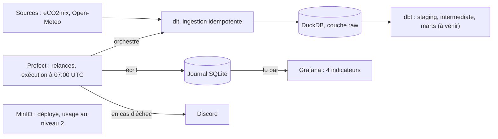

# Schéma d'architecture

Tout tourne dans Docker Compose (`docker compose up -d`).

## Lecture

- Rangée des données : les sources sont chargées par dlt dans DuckDB (couche `raw`), puis transformées par dbt.
- Rangée du pilotage : Prefect exécute l'ingestion chaque jour, alerte sur Discord en cas d'échec définitif, et alimente le journal SQLite que Grafana affiche.
- Le journal est séparé de l'entrepôt car DuckDB n'accepte qu'un écrivain à la fois (voir `decisions-architecture.md`).
- MinIO est déployé comme l'exige le socle ; les données n'y sont pas encore stockées.